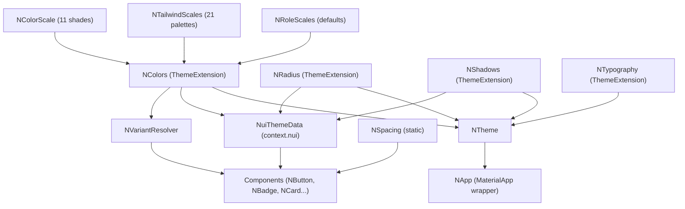

# Audit complet : Thème & Tokens pour le Scale — nui_flutter

## Résumé exécutif

Le package `nui_flutter` dispose d'une architecture de tokens bien pensée et mature. L'analyse statique passe sans aucune erreur, la structure des fichiers est propre, et le système `NColorScale` → `NColors` → `NVariantResolver` → composants forme un pipeline cohérent. Cependant, **plusieurs incohérences structurelles nuisent à la scalabilité** et méritent d'être corrigées avant une v1.0.

---

## 🏗️ Architecture actuelle



---

## ✅ Points forts

| Aspect | Évaluation | Détails |
|--------|:----------:|---------|
| **Color scale** | 🟢 Excellent | Oklab interpolation perceptuellement uniforme, 11 steps Tailwind-conformes |
| **ThemeExtension pattern** | 🟢 Excellent | `NColors`, `NRadius`, `NShadows`, `NTypography` tous correctement `ThemeExtension<T>` avec `copyWith` + `lerp` |
| **Variant system** | 🟢 Excellent | 6 variants × 7 roles avec `NVariantSupport` pour validation |
| **context.nui** | 🟢 Excellent | Accès centralisé via `NuiThemeData` avec fallback gracieux |
| **Tailwind scales** | 🟢 Excellent | 21 palettes pixel-perfect depuis OKLCH v4, générées par script |
| **Static analysis** | 🟢 Clean | `dart analyze` : 0 issues |
| **Barrel exports** | 🟢 Propre | Un seul `nui_flutter.dart` bien organisé par catégorie |

---

## 🔴 Problèmes critiques

### 1. `NVariantResolver` ignore le dark mode — shades hardcodées light-only

> [!CAUTION]
> **Impact : rendu cassé en dark mode pour les variants soft/subtle/outline sur les rôles non-neutral**

Dans [n_variant_resolver.dart](file:///Users/macbookpro/LehmoraProjects/nui_flutter/lib/src/theme/n_variant_resolver.dart#L52-L97), les shades utilisées pour les rôles colorés sont toujours les mêmes quel que soit le `brightness` :

```dart
// soft → always s100 bg + s700 text — même en dark mode !
case NVariant.soft:
  return NResolvedColors(foreground: scale.s700, background: scale.s100);
// outline → always s500 fg + s300 border
case NVariant.outline:
  return NResolvedColors(foreground: scale.s500, border: scale.s300);
```

En dark mode, `s100` (quasi blanc) et `s700` (sombre) sont inversés par rapport à ce qu'ils devraient être. Le `NColorScale` fournit déjà les helpers `softBgDark`, `textDark`, `borderDark`, mais ils ne sont **jamais utilisés** ici.

**Fix recommandé :** Passer `Brightness` à `NVariantResolver.resolve()` et brancher sur les helpers sémantiques du scale :
```dart
static NResolvedColors resolve(
  NColorRole role, NVariant variant, NColors colors,
) {
  final isDark = colors.brightness == Brightness.dark;
  // soft:
  foreground: isDark ? scale.s300 : scale.s700,
  background: isDark ? scale.softBgDark : scale.softBgLight,
}
```

---

### 2. Radius hardcodé dans de multiples composants — ignore `NRadius` / `NCardTheme`

> [!WARNING]
> **Impact : changer `NRadius(base: 12)` dans NApp n'affecte pas tous les composants**

| Composant | Radius hardcodé | Devrait utiliser |
|-----------|----------------|------------------|
| [NCard](file:///Users/macbookpro/LehmoraProjects/nui_flutter/lib/src/components/layout/n_card.dart#L127) | `BorderRadius.circular(8.0)` | `context.nui.radius.radiusMd` ou `NCardTheme.borderRadius` |
| [NBadge](file:///Users/macbookpro/LehmoraProjects/nui_flutter/lib/src/components/elements/n_badge.dart#L121) | `BorderRadius.circular(6.0)` | `context.nui.radius.radiusXs` |
| [NModal](file:///Users/macbookpro/LehmoraProjects/nui_flutter/lib/src/components/overlay/n_modal.dart#L115) | `BorderRadius.circular(12.0)` | `context.nui.radius.radiusLg` |
| [NModal action](file:///Users/macbookpro/LehmoraProjects/nui_flutter/lib/src/components/overlay/n_modal.dart#L299) | `BorderRadius.circular(8.0)` | `context.nui.radius.radiusMd` |
| [NChip](file:///Users/macbookpro/LehmoraProjects/nui_flutter/lib/src/components/elements/n_chip.dart#L91) | `16 / 20` hardcodé | `context.nui.radius.full` (pill) |

---

### 3. Padding/font size hardcodés — pas de lien avec le token spacing

> [!WARNING]
> **Impact : les composants ne scale pas de façon cohérente si on change la baseline**

Les méthodes `_getPadding()`, `_getFontSize()`, `_getIconSize()` dans [NButton](file:///Users/macbookpro/LehmoraProjects/nui_flutter/lib/src/components/button/n_button.dart#L295-L336), [NBadge](file:///Users/macbookpro/LehmoraProjects/nui_flutter/lib/src/components/elements/n_badge.dart#L182-L225), [NInput](file:///Users/macbookpro/LehmoraProjects/nui_flutter/lib/src/components/forms/n_input.dart#L415-L443), et [NChip](file:///Users/macbookpro/LehmoraProjects/nui_flutter/lib/src/components/elements/n_chip.dart#L127-L158) utilisent des valeurs littérales (`12`, `14`, `16`, `20`, etc.) au lieu des tokens `NSpacing`.

Exemples :
```dart
// NButton — hardcoded
case NButtonSize.md:
  return const EdgeInsets.symmetric(horizontal: 20, vertical: 12);
// Devrait être:
  return EdgeInsets.symmetric(horizontal: NSpacing.s5, vertical: NSpacing.s3);
```

---

## 🟡 Problèmes modérés

### 4. `NSpacing` est statique (abstract class) — pas de `ThemeExtension`

`NSpacing` est la seule catégorie de tokens qui ne participe **pas** au système de thème. C'est un `abstract class` avec des getters statiques → impossible de customiser le spacing par thème ou par écran.

**Recommandation :** Convertir en `ThemeExtension<NSpacing>` avec un `base` configurable (comme `NRadius`), et l'exposer via `context.nui.spacing`.

---

### 5. `NTextScale` — doublon avec le paramètre `textScale` de `NTheme`

[NTextScale](file:///Users/macbookpro/LehmoraProjects/nui_flutter/lib/src/theme/n_text_scale.dart) est déjà marqué `@Deprecated` mais reste exporté dans le barrel file et utilise un état mutable global (`static double _current`). C'est un anti-pattern pour les tests et le multi-window.

**Recommandation :** Supprimer l'export dans la v1.0 et marquer comme `@internal` ou le retirer complètement.

---

### 6. `NApp._buildTheme` ne forward pas `radiusScale`

Dans [NApp._buildTheme](file:///Users/macbookpro/LehmoraProjects/nui_flutter/lib/src/app/n_app.dart#L322-L339), le `radius` field est passé comme `radius.base` (un `double`), ce qui fait que `NTheme.lightTheme` recrée un nouveau `NRadius(base: radius)` en doublon. Le `NRadius` complet de `NApp.radius` n'est transmis qu'à `_mergeExtensions`, créant une incohérence entre les deux chemins de construction.

```dart
// NApp._buildTheme — passe radius.base (double), perd le NRadius object
return NTheme.lightTheme(
  colors: c,
  radius: radius.base,  // ← devrait passer radiusScale: radius
  ...
);
```

---

### 7. Component themes inégaux — seuls Button, Input, Card ont un ThemeExtension

Sur 20+ composants, seuls 3 ont un `ThemeExtension` dédié (`NButtonTheme`, `NInputTheme`, `NCardTheme`). Les composants comme `NAlert`, `NBadge`, `NChip`, `NModal`, `NProgress`, `NToggle`, etc. ne sont pas customisables via le thème.

---

### 8. `NCardTheme` enregistré mais pas lu par `NCard`

[NCardTheme](file:///Users/macbookpro/LehmoraProjects/nui_flutter/lib/src/theme/components/n_card_theme.dart) est enregistré dans [NTheme](file:///Users/macbookpro/LehmoraProjects/nui_flutter/lib/src/theme/n_theme.dart#L44) et [NApp](file:///Users/macbookpro/LehmoraProjects/nui_flutter/lib/src/app/n_app.dart#L348), mais [NCard.build()](file:///Users/macbookpro/LehmoraProjects/nui_flutter/lib/src/components/layout/n_card.dart#L126-L185) ne fait **jamais** `Theme.of(context).extension<NCardTheme>()`. Le `borderRadius` et `padding` du `NCardTheme` sont donc des dead fields.

---

### 9. Absence totale de tests

Les dossiers `test/theme/` et `test/components/` sont **vides**. Aucun test unitaire pour :
- La génération de `NColorScale.fromSeed()` (vérification des shades)
- Le `lerp` des ThemeExtensions
- Le `NVariantResolver` (résolution par variant/role/brightness)
- Le wiring de `NTheme` / `NApp`

---

## 🟢 Améliorations mineures

### 10. `NColors.lerp` ne lerp pas les `roleScales`

Dans [NColors.lerp](file:///Users/macbookpro/LehmoraProjects/nui_flutter/lib/src/theme/n_colors.dart#L267-L297), `roleScales` est snap-switched à 0.5 (`t < 0.5 ? roleScales : other.roleScales`). Pourtant `NColorScale.lerp` existe. Pour une transition de thème animée douce, il faudrait lerper chaque scale individuellement.

### 11. `NColors` manque d'`operator ==` et `hashCode`

Contrairement à `NColorScale` et `NRadius`, `NColors` ne définit pas `operator ==` ni `hashCode`. Cela peut causer des rebuilds inutiles.

### 12. Le `NButton` n'utilise pas `Material.Icons` depuis `NIcons` pour le close

Le composant [NAlert](file:///Users/macbookpro/LehmoraProjects/nui_flutter/lib/src/components/elements/n_alert.dart#L153) et [NBadge](file:///Users/macbookpro/LehmoraProjects/nui_flutter/lib/src/components/elements/n_badge.dart#L160) utilisent `Icons.close` (Material) au lieu de `NIcons.x` (Lucide), cassant la cohérence iconographique. Le même problème existe pour les icônes par défaut de `NAlert._getDefaultIcon()` (L162-178) qui utilise `Icons.*` Material.

### 13. `NCard` n'est pas exporté dans `NCardTheme`

[n_card_theme.dart](file:///Users/macbookpro/LehmoraProjects/nui_flutter/lib/src/theme/components/n_card_theme.dart) est importé en interne mais **pas exporté** dans le barrel file — les users ne peuvent pas customiser `NCardTheme` sans un import direct de path.

---

## Proposed Changes

### Phase 1 : Correctifs critiques (dark mode + radius)

#### [MODIFY] [n_variant_resolver.dart](file:///Users/macbookpro/LehmoraProjects/nui_flutter/lib/src/theme/n_variant_resolver.dart)
- Lire `colors.brightness` pour brancher les shades dark/light
- Utiliser les helpers sémantiques de `NColorScale` (`.solidDark`, `.softBgDark`, `.textDark`, `.borderDark`)

#### [MODIFY] Tous les composants avec radius hardcodé
- `NCard` → lire `NCardTheme` + fallback sur `context.nui.radius`
- `NBadge` → utiliser `context.nui.radius.radiusXs`
- `NModal` → utiliser `context.nui.radius.radiusLg`
- `NChip` → utiliser `context.nui.radius.full` pour le pill
- `_NModalActionButton` → utiliser `context.nui.radius.radiusMd`

---

### Phase 2 : Cohérence des tokens

#### [MODIFY] [n_app.dart](file:///Users/macbookpro/LehmoraProjects/nui_flutter/lib/src/app/n_app.dart)
- Forward `radiusScale: radius` dans `_buildTheme` au lieu de `radius: radius.base`

#### [MODIFY] [nui_flutter.dart](file:///Users/macbookpro/LehmoraProjects/nui_flutter/lib/nui_flutter.dart)
- Exporter `n_card_theme.dart`

#### [MODIFY] Components avec padding/fontSize hardcodés
- Remplacer les valeurs littérales par les tokens `NSpacing.sX`

#### [MODIFY] Components avec `Icons.*`
- Remplacer `Icons.close` par `NIcons.x`
- Remplacer `Icons.info_outline`, etc. par les équivalents Lucide dans NAlert

---

### Phase 3 : Améliorations structurelles

#### [MODIFY] [n_colors.dart](file:///Users/macbookpro/LehmoraProjects/nui_flutter/lib/src/theme/n_colors.dart)
- Ajouter `operator ==` et `hashCode`
- Lerper `roleScales` individuellement dans `NColors.lerp`

#### [MODIFY] [n_spacing.dart](file:///Users/macbookpro/LehmoraProjects/nui_flutter/lib/src/theme/n_spacing.dart)
- Convertir en `ThemeExtension<NSpacing>` avec `base` configurable
- Exposer via `context.nui.spacing`

#### Supprimer ou désexporter `NTextScale`

---

### Phase 4 : Tests

#### [NEW] `test/tokens/n_color_scale_test.dart`
#### [NEW] `test/tokens/n_variant_resolver_test.dart`
#### [NEW] `test/theme/n_colors_test.dart`
#### [NEW] `test/theme/n_theme_test.dart`

---

## Verification Plan

### Automated Tests
- `flutter test` après chaque phase
- `dart analyze lib/` (doit rester à 0 issues)

### Manual Verification
- Vérifier le rendu en dark mode des variants soft/subtle/outline sur un écran avec plusieurs `NButton`, `NBadge`, `NAlert`
- Vérifier qu'un `NApp(radius: NRadius(base: 16))` propage à tous les composants

---

## Open Questions

> [!IMPORTANT]
> 1. **Priorité dark mode vs radius ?** Le fix du `NVariantResolver` (dark mode cassé) est le plus impactant visuellement. Voulez-vous que je commence par ça ?
> 2. **`NSpacing` en ThemeExtension ?** C'est un changement d'API breaking. Préférez-vous garder le static pour la v0.x et migrer en v1.0 ?
> 3. **Component themes manquants** — Faut-il créer des `NAlertTheme`, `NBadgeTheme`, `NChipTheme` etc. maintenant ou les réserver pour plus tard ?
> 4. **Suppression de `NTextScale`** — OK de le retirer du barrel file dès maintenant (breaking change mineur) ?
